# Awesome-Audio-Processing-Noise-Suppression

  
  
  
  
  
  
  

<h3>🎧 The Definitive Guide to Real-Time Speech Enhancement, Neural Denoising & Digital Signal Processing (DSP)</h3>

  <strong>A curated directory of top-tier SaaS platforms, self-hosted open-source neural models, and low-latency DSP pipelines for voice isolation, acoustic echo cancellation (AEC), and background noise reduction.</strong>

---

## 📌 Overview & Scope

Welcome to **Awesome Audio Processing & Noise Suppression**! 🎙️ 

Whether you are building WebRTC voice bots, conversational AI pipelines, audio mastering tools, or podcast editors, background acoustic interference—such as keyboard clicks, fan noise, room reverberation, and traffic—severely degrades intelligibility and transcription accuracy.

This repository tracks the state-of-the-art ecosystem across two vital domains:
1. **☁️ Production SaaS Platforms**: Managed APIs, browser workstations, and virtual drivers for instant audio rescue and studio-grade mastering.
2. **💻 Open-Source & Self-Hosted Engines**: Embedded neural network weights (ONNX, TFLite, WASM) and C++/Rust DSP libraries providing causal, zero-cloud, privacy-first noise suppression at sub-10ms latency.

---

## 📑 Table of Contents

- [📊 Sector Overview & Market Dynamics](#-sector-overview--market-dynamics)
- [☁️ SaaS & Hosted Platforms](#️-saas--hosted-platforms)
- [💻 Open-Source GitHub Projects](#-open-source-github-projects)
- [🛠️ Emerging Toolkits & Libraries](#️-emerging-toolkits--libraries)
- [🤝 How to Contribute](#-how-to-contribute)
- [💖 Support](#-support)
- [⭐ Star History](#-star-history)
- [📜 Disclaimer](#-disclaimer)

---

## 📊 Sector Overview & Market Dynamics

The global AI audio processing and speech enhancement sector is estimated at **$1.8B to $2.3B**, scaling toward **$6.6B+ by 2030** at an accelerated **~30% CAGR**. 

The market exhibits a **bifurcated, moderately fragmented ecosystem structure**:
- **Core Infrastructure Layer (Concentrated)**: Foundational acoustic models, OS-level audio routing, and low-power DSP hardware silicon are concentrated among Big Tech and semiconductor leaders (Google, Apple, Microsoft, Qualcomm, NVIDIA).
- **Application & Specialty Layer (Fragmented)**: The creator-facing editing tools, vertical WebRTC plugins, conversational voice agents, and dedicated neural denoising algorithms remain highly fragmented, driven by competitive innovation between independent venture-backed startups, bootstrapped tools, and open-source models.

---

## ☁️ SaaS & Hosted Platforms

A comparison of leading hosted platforms, sorted in descending order of **company scale (annual revenue / valuation)**:

| Product | 🏢 Company Scale | 💳 Pricing (Starting Paid Tier) | 🎁 Free Tier / Trial Limits | 🔍 Key Features & Architectural Focus |
| :--- | :--- | :--- | :--- | :--- |
| **[Adobe Podcast Enhance Speech](https://podcast.adobe.com/enhance)** | **$25.97B Revenue** (~$90B Market Cap) | **$9.99/mo** (Express / Firefly Pro annual plan) | **Free forever**: Max 30 mins/file, 500 MB/file, up to 1 hr total processing/day | Browser-based AI speech enhancement removing room reverb, echo, and background noise while synthesizing studio microphone warmth. |
| **[ElevenLabs Voice Isolator](https://elevenlabs.io/)** | **~$600M ARR** ($22B Valuation) | **$5/mo** (Starter plan; billed monthly) | **Free forever**: 10,000 credits/mo (~10 mins audio), personal/non-commercial use only with attribution | Precision AI voice extraction isolating human dialogue from heavily corrupted recordings, noisy street environments, and crowded rooms. |
| **[Descript Studio Sound](https://www.descript.com/)** | **~$50M–$55M ARR** ($550M Valuation) | **$16/mo per user** (Hobbyist annual; $24/mo monthly) | **Free forever**: 1 media hour/mo, 100 one-time AI credits, 720p watermark-free exports, 5 GB storage | Integrated timeline editor featuring one-click Studio Sound audio cleanup, filler-word removal, automatic transcription, and AI voice cloning. |
| **[Krisp](https://krisp.ai/)** | **~$38M–$41M ARR** (~$100M Valuation) | **$8/mo per user** (Core annual; $16/mo monthly) | **7-day free trial**: Full access (unlimited noise cancellation, transcription, meeting notes), 0 days ongoing free tier | Virtual microphone and speaker driver providing bi-directional, real-time noise, background voice, and acoustic echo cancellation for live calls. |
| **[Auphonic](https://auphonic.com/)** | **~$1M ARR** (Bootstrapped / Independent) | **$11/mo** (9 audio hours/mo annual; $13/mo monthly; or $12 one-time for 5 hrs) | **Free forever**: 2 hours of processed audio per month with all standard processing algorithms | Automated audio post-production web service: intelligent leveler, broadcast loudness normalization (EBU R128), and adaptive noise reduction. |
| **[Cleanvoice AI](https://cleanvoice.ai/)** | **~$200k–$500k ARR** (Bootstrapped / Independent) | **$11/mo** (€10/mo for 10 hours; or €10 pay-as-you-go credits) | **Free trial**: 30 minutes of processing total, no credit card required, 0 hours ongoing free tier | Dedicated post-processing algorithm specifically targeting filler words (*um*, *uh*), stuttering, mouth clicks, breath sounds, and ambient noise. |

---

## 💻 Open-Source GitHub Projects

Curated open-source neural noise suppression and speech enhancement models, sorted in descending order by **GitHub Stars** ⭐:

| Project & Repository | ⭐ Stars | 📄 License | ⚡ Latency / Architecture | 🎯 Description & Best Use Case |
| :--- | :--- | :--- | :--- | :--- |
| **[noise-suppression-for-voice](https://github.com/werman/noise-suppression-for-voice)** |  | GPL-3.0 | Real-time / C++ | Real-time noise suppression plugin based on Xiph's RNNoise. Packaged as LADSPA, VST2, VST3, and LV2 plugins for system-wide microphone filtering on Linux (PipeWire/PulseAudio), Windows, and macOS. |
| **[RNNoise](https://github.com/xiph/rnnoise)** |  | BSD-3-Clause | ~10ms / Recurrent Neural Network | The battle-tested, classic lightweight baseline for real-time speech enhancement combining classical DSP band-energy analysis with a compact RNN. Ideal for resource-constrained embedded targets. |
| **[DeepFilterNet](https://github.com/Rikorose/DeepFilterNet)** |  | MIT | ~10ms / Deep Filtering + Rust/WASM | Full-band (48kHz) neural speech enhancement. Combines spectral envelope estimation with deep filtering coefficients. Delivers competitive suppression and runs client-side in browsers via WebAssembly and AudioWorklets. |
| **[Asteroid](https://github.com/asteroid-team/asteroid)** |  | MIT | PyTorch Research Toolkit | The popular PyTorch-based audio source separation and speech enhancement toolkit for researchers and practitioners. Supports modular filterbanks, complex encoders, and bleeding-edge separation architectures. |
| **[Resemble Enhance](https://github.com/resemble-ai/resemble-enhance)** |  | Apache-2.0 | Two-Stage Denoiser + Enhancer | State-of-the-art dual-stage speech enhancement: a neural denoiser strips acoustic noise followed by a conditional flow matching enhancer that restores high-frequency harmonics and voice fidelity. |
| **[Facebook Denoiser](https://github.com/facebookresearch/denoiser)** |  | CC-BY-NC 4.0 | Real-time Causal / Demucs Waveform | Real-time speech enhancement directly in the raw time domain. Based on Meta's causal Demucs architecture, running efficiently on modern CPUs without STFT artifacting. |
| **[GTCRN](https://github.com/Xiaobin-Rong/gtcrn)** |  | Apache-2.0 | Ultra-low MACs / Group Conv RNN | An ultra-lightweight complex time-frequency residual network for low-latency speech enhancement. Achieves superior DNSMOS scores while maintaining minimal computational overhead for edge devices. |
| **[DTLN](https://github.com/breizhn/DTLN)** |  | Apache-2.0 | ~8ms / Dual-Signal LSTM | Dual-signal Transformation LSTM Network combining STFT magnitude masking with raw time-domain feature refinement. Fully exportable to ONNX/TFLite, ideal for in-process voice agent pipelines. |
| **[DPDFNet (HushMic)](https://github.com/ceva-ip/DPDFNet)** |  | Apache-2.0 | 80ms / Ceva Dual-Path DF | High-performing open-source speech enhancement model evaluated on DNSMOS P.835 benchmarks (scoring 3.20 overall, 4.15 background reduction). Excels in aggressive café background babble. |

---

## 🛠️ Emerging Toolkits & Libraries

- **[denoise-voice-clarity](https://www.npmjs.com/package/denoise-voice-clarity)**: Complete browser WebAssembly noise suppression pipeline wrapping DeepFilterNet 3 with high-pass filters, presence EQ, and soft compressors.
- **[livekit-plugins-dtln](https://pypi.org/project/livekit-plugins-dtln/)**: Pretrained ONNX weights bundled with LiveKit's real-time audio pipeline for AI voice agents.
- **[ClearerVoice-Studio](https://github.com/modelscope/ClearerVoice-Studio)**: Alibaba ModelScope's AI audio toolkit for speech enhancement, speech separation, and bandwidth expansion.

---

## 🤝 How to Contribute

Contributions are warmly welcomed! 🚀

1. Fork this repository.
2. Add your product, model, or tool to `README.md` following the table schema.
3. Ensure links, licensing, and pricing/star information are verified.
4. Submit a Pull Request with a clear description of why the tool should be included.

---

## 💖 Support

If you found this curated list helpful, please consider showing your support:
- ⭐ **Star** this repository on GitHub to boost its visibility!
- 🍴 **Fork** and share it with your fellow audio engineers and ML developers.
- ☕ **Buy me a coffee**: Support ongoing open-source curation and development via the [GitHub Sponsors Dashboard](https://github.com/sponsors/ishandutta2007).

Thank you for helping keep the audio processing and speech enhancement ecosystem vibrant, open, and accessible! 🙌

---

## 📈 Star History

---

## 📜 Disclaimer

- This is a community-curated list compiled for educational and informational purposes.
- Audio and speech enhancement applications frequently handle confidential or sensitive voice communications. Deploying self-hosted, open-source models (such as DTLN, DeepFilterNet, or RNNoise) guarantees that audio data never leaves your infrastructure, whereas SaaS solutions process data on third-party cloud infrastructure. Always review data privacy agreements and compliance guarantees before deployment.

---

  Built with ❤️ for audio engineers, ML researchers, and builders shaping the future of voice technology.

